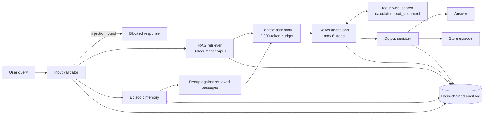

# Intelligent Research Assistant — System Architecture

Integration point 4 of the Volume III capstone: a short system architecture document for the assistant in `research_assistant.py`.

## Components

## Data flow

1. The input validator checks the query against injection patterns. A match ends the request with a refusal; nothing reaches the model.
2. The retriever embeds the query and ranks the corpus by cosine similarity; episodic memory ranks past sessions the same way.
3. Recalled episodes that repeat a retrieved passage (cosine similarity above 0.85) are dropped, so the context does not say the same thing twice.
4. Context assembly numbers the passages, best first, and truncates or drops passages to stay within 2,000 tokens.
5. The ReAct loop alternates thought, action and observation. Each turn is cut at "Observation:" so that observations come only from tools.
6. The output sanitizer redacts secrets before the answer leaves the system. Only completed, clean answers are stored as new episodes.
7. Every step writes an audit entry whose hash covers the previous entry's hash.

## Three design decisions

**Validate before retrieving.** The injection check runs first, so a blocked request costs no embedding or model calls and leaves no trace in memory. The cost: an attack phrased in a way the patterns do not anticipate passes straight through. The output sanitizer and the agent's system prompt are the later layers that remain.

**Budget the retrieved context, not the whole prompt.** Retrieved passages are the part of the prompt that grows with the corpus, so that is where the limit is enforced, best passage first. The system prompt and memory are small and fixed in size. A larger corpus would need the budget to cover memory as well.

**Store only clean, completed answers.** An answer that failed or that the sanitizer changed is not written to episodic memory. This keeps one bad turn from becoming a "fact" that later sessions recall, which is the memory-poisoning risk Chapter 18 describes.

## Known limits

- The assistant has no relevance threshold: asked something the corpus cannot answer, it answers from the best-ranked passage anyway (evaluation case E10). A minimum retrieval score, with a fallback answer of "not available", would fix that.
- The default embeddings are a hashed bag of words; they match words, not meaning. Live mode uses `text-embedding-3-small`.
